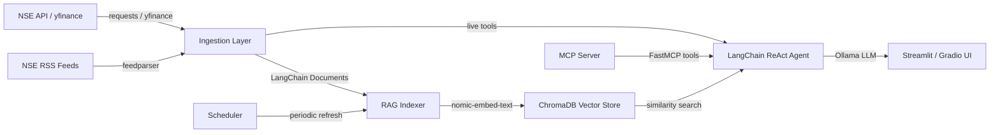

# 📈 NSE Intelligence

> A **100% local**, privacy-first AI chatbot for the **National Stock Exchange of India (NSE)** — real-time stock prices, corporate announcements, financial results, and market intelligence powered by LLMs running on your machine.


---

## ✨ Features

| Feature | Description |
|---|---|
| 🤖 **AI Chat Agent** | LangChain ReAct agent (NSE-GPT) answers natural-language questions about Indian equities |
| 📊 **Live Stock Prices** | Two-tier fetching — NSE internal API (real-time) with yfinance fallback (~15 min delayed) |
| 📰 **NSE RSS Feeds** | Ingests 7 official NSE feed categories: corporate announcements, financial results, insider trading, corporate actions, press releases, investor complaints, and circulars |
| 🧠 **RAG Knowledge Base** | LlamaIndex + ChromaDB vector store for semantic search over ingested documents |
| 🔌 **MCP Server** | FastMCP tool server exposing all NSE data tools to any MCP-compatible LLM agent |
| ⏰ **Auto-Refresh Scheduler** | APScheduler keeps the RAG index fresh (every 5 min) and rotates NSE session cookies (every 15 min) |
| 🖥️ **Dual UI** | Streamlit (full-featured dashboard + chat) and Gradio (lightweight chat) interfaces |
| 🔒 **Fully Local** | All processing on-device via Ollama — **no data ever leaves your machine** |

---

## 🏗️ Architecture

```
nse_intelligence/
├── agent/
│   └── langchain_agent.py    # LangChain ReAct agent with tool bindings
├── ingestion/
│   ├── price_fetcher.py      # NSE API + yfinance price quotes
│   └── rss_loader.py         # NSE RSS feed parser → LangChain Documents
├── rag/
│   ├── indexer.py            # LlamaIndex + ChromaDB indexer (full/incremental)
│   └── retriever.py          # ChromaDB similarity search for the agent
├── mcp_server/
│   └── rss_tools.py          # FastMCP server exposing NSE tools
├── scheduler/
│   └── feed_scheduler.py     # APScheduler for auto-refresh
├── ui/
│   ├── streamlit_app.py      # Streamlit dashboard + chatbot
│   └── gradio_app.py         # Gradio chat interface
├── requirements.txt
└── __init__.py
```
 
### Data Flow



---

## 📋 Prerequisites

- **Python 3.10+**
- **[Ollama](https://ollama.ai/)** installed and running
- Required Ollama models pulled:
  ```bash
  ollama pull llama3.2
  ollama pull nomic-embed-text
  ```

---

## 🚀 Quick Start

### 1. Clone & Install

```bash
cd nse_intelligence
python -m venv .venv
# Windows
.venv\Scripts\activate
# macOS/Linux
source .venv/bin/activate

pip install -r requirements.txt
```

### 2. Configure Environment

Create a `.env` file in the project root (all values have sensible defaults):

```env
# Ollama
OLLAMA_BASE_URL=http://localhost:11434
OLLAMA_MODEL=llama3.2
OLLAMA_EMBED_MODEL=nomic-embed-text

# ChromaDB
CHROMA_PERSIST_DIR=./chroma_db

# Scheduler intervals
RAG_REFRESH_INTERVAL_MINUTES=5
NSE_SESSION_REFRESH_MINUTES=15
```

### 3. Build the RAG Index

```bash
python rag/indexer.py --full
```

### 4. Launch the UI

**Streamlit (recommended):**
```bash
streamlit run ui/streamlit_app.py
```

**Gradio (alternative):**
```bash
python ui/gradio_app.py
# Opens at http://localhost:7860
```

### 5. (Optional) Start the Background Scheduler

```bash
python scheduler/feed_scheduler.py &
```

### 6. (Optional) Run the MCP Server

```bash
python mcp_server/rss_tools.py
```

---

## 🔧 Components in Detail

### 🤖 Agent (`agent/langchain_agent.py`)

A **LangChain ReAct agent** backed by Ollama (`llama3.2`) with four bound tools:

| Tool | Purpose |
|---|---|
| `fetch_rss_tool` | Fetch latest NSE RSS announcements by category |
| `get_stock_quote` | Get live/delayed price for any NSE symbol |
| `rag_search` | Semantic search over the ChromaDB knowledge base |
| `search_symbol_announcements` | Filter corporate announcements by symbol/keyword |

The agent uses a structured output format (Summary → Live Data → Latest News → Analysis → Sources) and enforces hard rules against hallucinating prices or giving financial advice.

### 📰 Ingestion (`ingestion/`)

- **`rss_loader.py`** — Parses 7 official NSE RSS feeds into LangChain `Document` objects with rich metadata (category, pub date, source link).
- **`price_fetcher.py`** — Two-tier price strategy:
  1. **NSE internal JSON API** (real-time, requires session cookie rotation)
  2. **yfinance fallback** (~15 min delayed, always available)

### 🧠 RAG (`rag/`)

- **`indexer.py`** — Uses LlamaIndex with Ollama embeddings (`nomic-embed-text`) and ChromaDB for persistent vector storage. Supports full rebuild (`--full`) and incremental updates (`--update`).
- **`retriever.py`** — Direct ChromaDB similarity search with configurable `top_k` and time-based filtering (`max_age_hours`). Converts distances to similarity scores and formats results for the LLM.

### 🔌 MCP Server (`mcp_server/rss_tools.py`)

A **FastMCP** server exposing 7 tools to any MCP-compatible client:

| MCP Tool | Description |
|---|---|
| `fetch_rss` | Fetch NSE RSS feed by category |
| `get_quote` | Stock price snapshot via yfinance |
| `list_symbols` | List symbols in NIFTY50, NIFTYBANK, or NIFTYIT |
| `search_announcements` | Search corporate announcements by symbol/keyword |
| `get_corporate_actions` | Dividends, splits, bonus history via yfinance |
| `get_financial_results` | Financial result announcements from RSS |
| `get_all_feeds_summary` | Daily briefing — latest 3 items from every feed |

### ⏰ Scheduler (`scheduler/feed_scheduler.py`)

An **APScheduler** background process that:
- Refreshes the RAG index every 5 minutes (configurable)
- Rotates NSE session cookies every 15 minutes
- Runs in `Asia/Kolkata` timezone
- Performs an immediate refresh on startup

### 🖥️ UI

#### Streamlit (`ui/streamlit_app.py`)
Full-featured dashboard with:
- **Chat interface** with conversation history and quick prompts
- **Sidebar watchlist** with live price cards
- **Interactive candlestick charts** (3-month, via Plotly)
- **Live RSS feed browser** by category
- Dark theme optimized for financial data

#### Gradio (`ui/gradio_app.py`)
Lightweight alternative with:
- Chat interface with example prompts
- Retry, undo, and clear controls
- Dark theme

---

## 📡 Supported NSE RSS Feeds

| Category | Source |
|---|---|
| Corporate Announcements | `nsearchives.nseindia.com/content/RSS/corporate_announcement.xml` |
| Financial Results | `nsearchives.nseindia.com/content/RSS/financial_results.xml` |
| Insider Trading | `nsearchives.nseindia.com/content/RSS/insider_trading.xml` |
| Corporate Actions | `nsearchives.nseindia.com/content/RSS/corporate_actions.xml` |
| Press Releases | `nsearchives.nseindia.com/content/RSS/press_release.xml` |
| Investor Complaints | `nsearchives.nseindia.com/content/RSS/investor_complaints.xml` |
| Circulars | `www.nseindia.com/content/RSS/circulars.xml` |

---

## 🛠️ Tech Stack

| Layer | Technology |
|---|---|
| **LLM** | Ollama (llama3.2) |
| **Embeddings** | Ollama (nomic-embed-text) |
| **Agent Framework** | LangChain 0.3 (ReAct agent) |
| **RAG Framework** | LlamaIndex 0.10 |
| **Vector Store** | ChromaDB 0.5 |
| **MCP Server** | FastMCP 0.4 |
| **Data Feeds** | NSE RSS (feedparser), yfinance |
| **UI** | Streamlit 1.40 / Gradio 5.9 |
| **Charts** | Plotly 5.24 |
| **Scheduler** | APScheduler 3.10 |
| **Logging** | Loguru |

---

## 💬 Example Queries

```
📈 What is the current price of Reliance Industries?
📢 Show me the latest corporate announcements
💰 Any upcoming dividends for HDFC Bank?
📊 Summarize TCS financial results
🔍 What insider trading activity has there been recently?
📰 What circulars has NSE released this week?
⚡ Compare prices of TCS, INFY, and WIPRO
```

---

## ⚠️ Disclaimer

> **This tool is for informational and educational purposes only.** It does **not** provide financial advice, buy/sell recommendations, or investment guidance. Stock data may be delayed up to 15 minutes. Always verify data on [nseindia.com](https://www.nseindia.com) before making any financial decisions.

